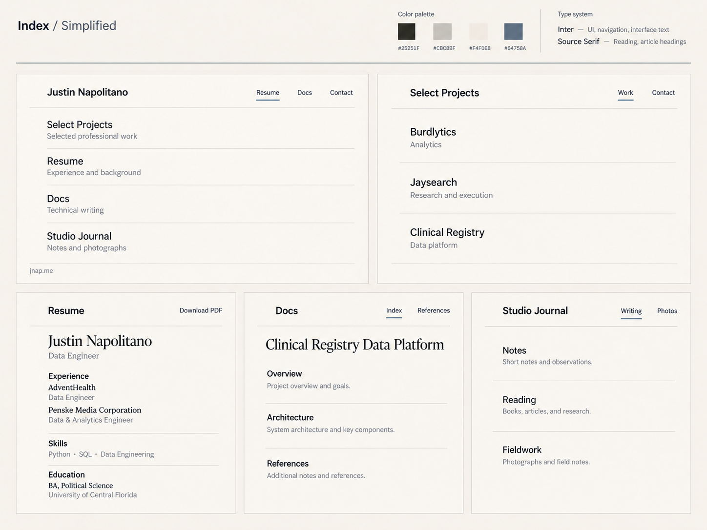

# Unified brand: Index / Simplified, without title marks

Status: visual direction approved by Justin on 2026-10-22; implementation remains planned.

Reference SHA-256: `aa73b7441e83d5a5930d776c604209a09f54206a676314923037201bd695eef1`.

## Design authority

The approved reference is the final **Index / Simplified** board with the bracket characters removed. Earlier Fieldnotes, blue Index, Quiet Editorial, and Editorial Refinement boards are superseded. Do not introduce the rejected serif mastheads, italics, double rules, huge headings, architecture photos, or logo characters. The image supplies visual direction, not complete production content or a license to invent career claims. Preserve real content and application functions.

## Shared visual contract

- Text-only site titles. No bracket, monogram, icon, or replacement symbol preceding the title. Preserve each site's own name.
- Warm paper `#F4F0E8`, ink `#25251F`, stone `#CBC8BF`, restrained slate `#64758A`. Avoid large blue areas. Slate is an occasional focus/active detail, not the default text color.
- Inter for UI/navigation/body, Source Serif 4 for reading headings and resume name. Use existing licensed local assets where possible, with system sans/serif fallbacks. Avoid a new remote font service or dependency solely for this rollout.
- At desktop size, body 15–16px with comfortable line height; site titles roughly 20–24px; main headings 24–28px; no display heading above 32px without a specific justified exception. These are implementation targets translated from the board, not sampled font measurements. Print uses readable point sizes appropriate to the paper format.
- Modest regular/medium weights, simple horizontal text navigation, thin neutral dividers, generous but purposeful spacing. Do not reintroduce oversized bold name blocks, margin-number sidebars, repeated navigation, big hero areas, nested cards, gradients, decorative shadows, or excessive pills.
- No decorative photos or image placeholders on the landing pages. Preserve meaningful project screenshots, document figures, real journal media, and user content where the actual task requires them; the reference's lack of decorative imagery does not authorize deleting content.
- Names, readable type hierarchy, spacing, and shared materials establish the family resemblance. No shared runtime service or cross-repo component-package migration is required.
- Keep useful content close to the top, with a comfortable maximum reading width and responsive alignment. Let functional data tables, dashboards, and interactive tools keep the structure their tasks require.

## Accessibility and behavior

Ensure at least WCAG AA text contrast; stone is a divider/surface color, not body text. Slate-on-paper must be checked for the actual font size and adjusted darker where necessary. Keep visible keyboard focus, semantic landmarks/headings, reduced-motion preferences, 200% zoom support, and usable mobile touch targets. Check reflow at 390px, 768px, and 1440px, and at 320px for overflow. No navigation or application functionality may disappear to simplify the screenshot.

Preserve routes, canonical URLs, contact redirects, authentication, invites, authorization, API boundaries, data classifications, publishing permissions, integrations, and content provenance. Do not turn protected tools or private entries into public examples. Screenshots must use synthetic or already-public content. No new dependencies, remote integrations, or security-control changes are needed for the visual work. Any later expansion into sensitive functionality needs its own scoped review.

## Content and source authority

Retain verified content and the repository's existing content authority. The board is a compact illustration, not an instruction to remove resume bullets, invent metrics, publish journal drafts, replace document text with placeholder headings, or turn a research toolkit into a generic landing page. Reconcile the resume content authority and web/PDF outputs before making copy changes. This rollout is visual; career rewriting is a separate task.

## Rollout and review

1. Establish this versioned contract and approved image; implement the personal link site as the first reference preview.
2. Apply to the web resume, PDF resume, Select Projects, and Docs; compare them together before proceeding.
3. Apply to Burdlytics, Jaysearch, Clinical Registry, Journal, Hiring, and News Reader, preserving each product's function.
4. Review older site variants for their active deployment and content ownership. Align retained surfaces, or prepare redirects/retirement proposals; do not redirect, archive, or delete without a concrete reviewed decision.
5. Offer the identity as an optional theme in reusable templates, not a mandatory identity for unrelated clients/products.

Each repository issue is a self-contained draft implementation plan. Existing branch/governance rules still apply: register the authoritative repo-local plan and worker scope before implementation where required; do not treat issue creation as finalized governance metadata. Use isolated branches/PRs and preserve unrelated work. Deployment and merges are outside this planning task.

## Acceptance evidence

Provide before/after desktop/mobile captures, a compact token/typography comparison with this reference, keyboard/reflow/contrast checks, existing relevant build/check results, and confirmation that routes, content authority, and access controls were preserved. For PDF, inspect page breaks and selectable text, and compare print/export to the web resume. Do not add screenshot-only tests that merely mirror implementation. A PR records exact commands and any pre-existing failures, and links this pinned design contract. No application builds were run during this documentation-only planning task.
